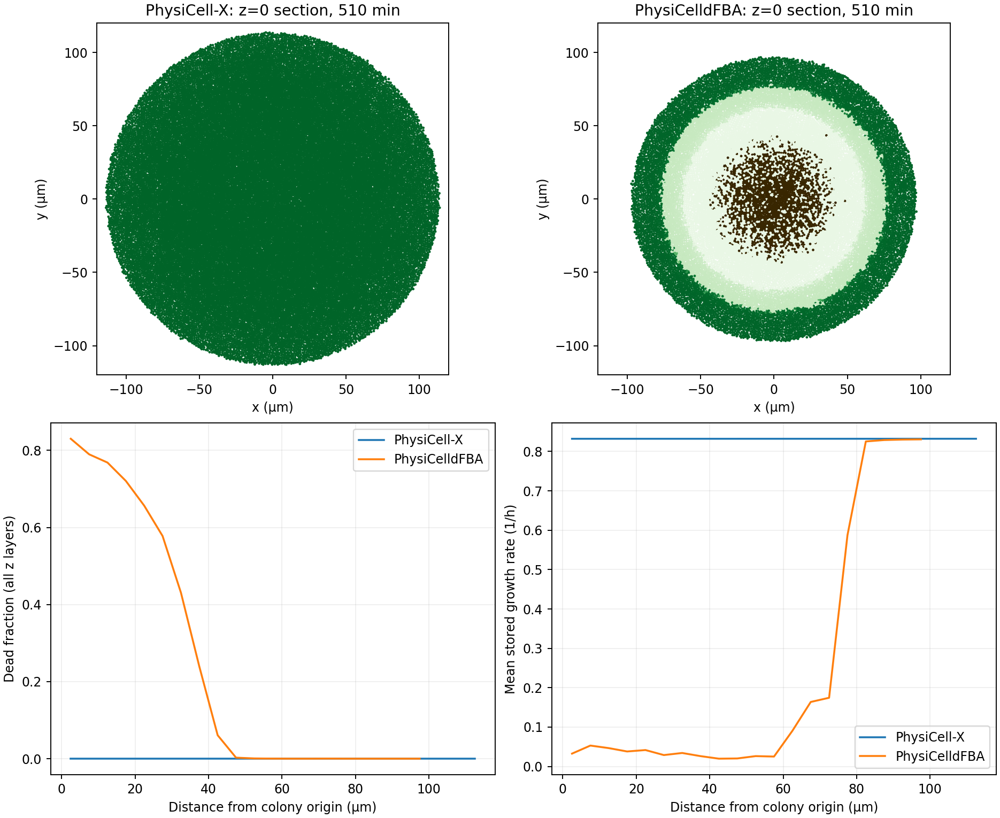

# Latest saved outputs: growth and death divergence

Compared `PhysiCell-X/output` with `../PhysiCelldFBA/output` at all 18 common numbered snapshots, 0–510 minutes. These are the main output folders requested, not the separate corrected 180-minute diagnostic pair. The reference numbered outputs were saved on August 27; X's on September 10. The reference `final.xml` is stale (100.01 minutes) and was excluded. Neither numbered series demonstrates completion of the configured 600 minutes.

## Findings at 510 minutes

| Metric | PhysiCell-X | PhysiCelldFBA |
|---|---:|---:|
| Cells | 186,796 | 111,254 |
| Dead cells | 0 | 11,435 |
| Mean stored growth rate (1/h) | 0.832134 | 0.331965 |
| Minimum oxygen | 18.0786 | 4.23239 |
| Minimum glucose | 16.9394 | -0.403105 |
| Negative glucose voxels | 0 | 10,070 |
| Negative acetate voxels | 0 | 27,493 |
| Mean recorded pressure | 2.67372 | 0.672581 |
| Cell centers outside z bounds | 10,074 | 3,009 |

Concentrations use the saved model units. Initial fields, positions and cell volumes match; initial orientations differ. The saved settings match except for an empty `use_2D` tag in X versus `false` in the reference; the comparator verifies the actual meshes and bounds agree. Both settings specify seed 50, FBA interval 0.01 minutes and diffusion step 0.001 minutes. Saved settings do not establish actual runtime thread/rank counts or executable provenance.

## Why green cells versus death patterns?

The coloring function is identical in both projects (`custom_modules/custom.cpp`, X lines 227–289). Green indicates positive FBA growth, with saturation set by growth relative to its configured maximum. Brown indicates actual death; yellow and red indicate nonzero necrosis/apoptosis rates and do not by themselves mean a cell is dead.

X retains plentiful glucose and oxygen, so high growth and green cells are consistent with its fields. In the reference, minimum glucose declines to 0.493 at 390 minutes and becomes negative by 420 minutes. The first saved deaths appear at 420 minutes, then rise to 222 at 450, 1,295 at 480 and 11,435 at 510. This supports nutrient depletion followed by metabolic failure as the immediate cause. The configured glucose Km is 0.01: X's minimum glucose of 16.94 is still far above that kinetic scale.

The shared FBA code clamps sampled negative concentrations to zero before setting uptake bounds, requires the configured ATP maintenance flux (`R_ATPM`, threshold 8.39), and raises the selected death rate when optimization is nonoptimal. Circular starvation/death patterns are consistent with nutrient gradients in this initially circular colony. The spatial and radial plots below inspect that interpretation; the exact time-dependent formation of individual bands is not causally established by endpoint data alone.

## Code assessment

**Strong evidence for differing substrate-application histories, rather than a missing X death pathway.** At 30 minutes, X's integrated glucose depletion is only 0.124144 times the reference's. This discrepancy exists before death and agrees with the previously diagnosed correction of a cached 0.01-minute source increment applied on 0.001-minute secretion steps. The reference 30-minute field hash is identical to the old reference field used in the previous reassessment. This is therefore a comparison against the old saved reference behavior even though the reference working source has since been repaired. Exact producing binaries are not recorded with these outputs, so output dates alone cannot prove their build contents.

The current X source recomputes uptake/export constants using the actual secretion timestep (`BioFVM/BioFVM_basic_agent.cpp:516`). FBA still primes the cache with its own timestep (`addons/dFBA/src/dfba_intracellular.cpp:716`), but the source application now overwrites it before use. Earlier controlled tests established the tenfold cache error and verified the correction. In the separate fresh, corrected pair, the largest integrated substrate difference at 180 minutes was 0.01447%. That control does not establish agreement at 510 minutes.

**No disabled death check found in the inspected X path.** The MPI cell update calls intracellular updates and bundled phenotype updates; `core/PhysiCell_cell.cpp:477` checks death. The FBA metabolic-death logic is the same as the reference after normalizing line endings. The high X substrate concentrations provide a direct explanation for why its death condition is not reached. This was a focused source review, not a complete validation of every MPI cell lifecycle path.

**Remaining shared numerical limitation:** the FBA availability cap in `addons/dFBA/src/dfba_intracellular.cpp:527` checks each cell against the full voxel amount independently. Multiple cells can therefore request the same available substrate. The explicit net-export update in `BioFVM/BioFVM_basic_agent.cpp:549` has no collective availability limit. Deterministic serialization prevents lost updates but does not guarantee nonnegative concentrations. This is a real code limitation in X as well as the reference; X's current saved fields have not reached the depleted regime that exposes it. It is a plausible contributor to the reference's negative fields, alongside its historical timestep problem, not a separately quantified cause of every negative voxel.

**Separate packing discrepancy:** X has substantially greater pressure and more cells outside the thin z domain. Out-of-domain cells can stop contributing sources and retain stored growth values. These effects deserve separate assessment but cannot explain the roughly eightfold early substrate difference, which precedes crowding and death.

No production source, settings or original outputs were changed for this assessment. No new simulations were launched. Generated comparison data: [cell metrics](cell_metrics.csv), [substrate metrics](substrate_metrics.csv), [input hashes](provenance.json), [radial death profiles](radial_death.csv), [substrate plot](substrates.png).
