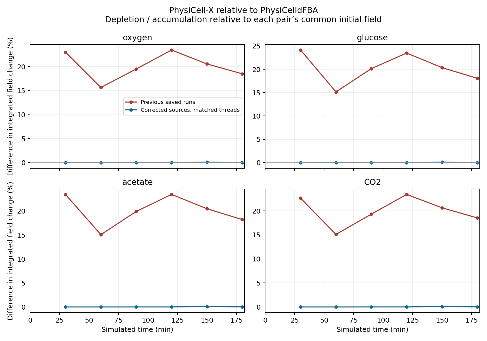
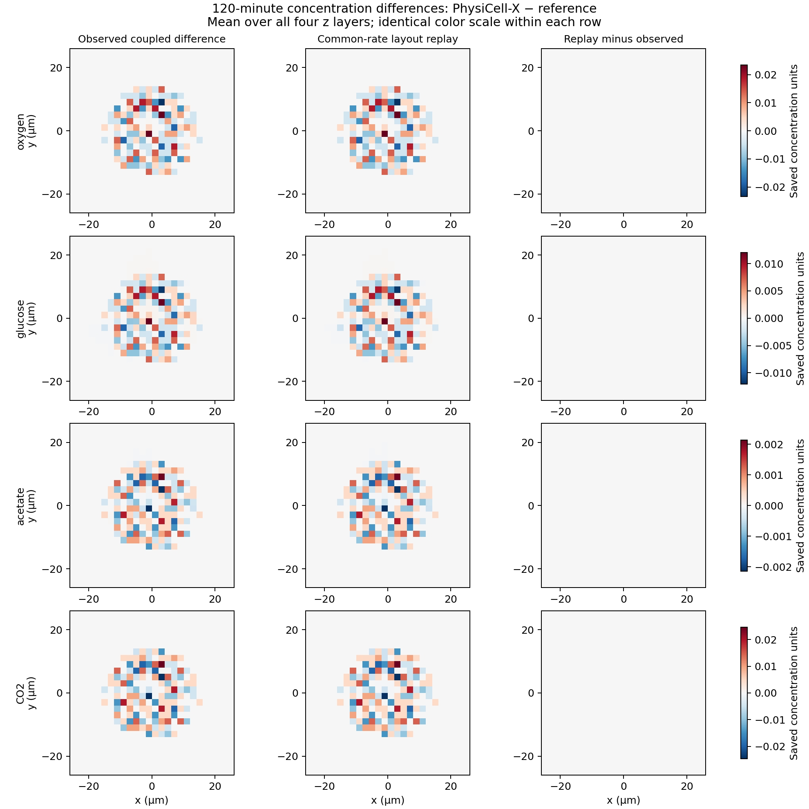

**Completed comparison through 180 minutes.** Both corrected colony runs reached 180 minutes with complete snapshots.

The largest integrated substrate-field difference at this endpoint is **0.01447%**, compared with **18.52%** in the previous saved runs. Across all completed paired times, the largest corrected difference is 0.1018%. These numbers cover oxygen/glucose depletion and acetate/CO₂ accumulation.

Both projects now use deterministic source application within each voxel and the actual secretion timestep. Through the assessed interval, the largest cumulative requested-versus-applied source error is 5.86e-16 relative. The shared-voxel tests pass at 1, 2 and 8 threads, including changed rates, changed timesteps and reversed cell order.

At **180 minutes**, the comparison is:

| Substrate | Previous field-change difference | Corrected field-change difference | Corrected perturbation L2 error | Corrected absolute-field L2 error |
|---|---:|---:|---:|---:|
| oxygen | +18.5% | +0.01447% | 3.81% | 0.006157% |
| glucose | +18.07% | +0.007168% | 1.312% | 0.002807% |
| acetate | +18.22% | +0.008069% | 1.814% | 1.814% |
| CO2 | +18.52% | +0.01304% | 3.292% | 3.292% |

Field change means voxel-volume-weighted depletion or accumulation relative to the initial field. It is distinct from cumulative uptake because diffusion exchanges material with the Dirichlet boundaries. Perturbation L2 measures the spatial error relative to the reference depletion/accumulation; absolute-field L2 uses the full reference concentration. The latter explains why oxygen and glucose curves can look very similar even when their small deficits differ.

**Absolute effect of the correction at 30 minutes.** The values below divide each new integrated field change by that same project’s previous saved change. A ratio near 0.1 means approximately ten times less depletion or accumulation. The PhysiCell-X ratios directly match the expected scale of correcting a cached 0.01-minute increment to a 0.001-minute secretion step. These are observed combined-intervention results, not a factorial estimate separating timestep, race and thread-count effects.

| Substrate | X corrected / previous | Reference corrected / previous |
|---|---:|---:|
| oxygen | 0.1000069 | 0.12303139 |
| glucose | 0.10001173 | 0.12414209 |
| acetate | 0.10001064 | 0.12346694 |
| CO2 | 0.10000575 | 0.12264917 |

**Source accounting before the next diffusion step:**

| Substrate | Difference in cumulative requested amounts | X accounting error | Reference accounting error |
|---|---:|---:|---:|
| oxygen | +0.018911% | -1.95e-16 | 5.86e-16 |
| glucose | +0.018867% | 1.95e-16 | 1.95e-16 |
| acetate | +0.018345% | 0 | -1.35e-16 |
| CO2 | +0.018911% | 0 | 0 |

The budgets sum `dt × net_export_rate` independently of the measured field increment. Conventional secretion and uptake coefficients are zero in this colony. Accounting errors are dimensionless relative errors; amounts retain the model’s concentration × voxel-volume units. All ranks and all source steps through the endpoint are included. The extra tick after the final numbered snapshot is excluded.

**FBA timing and causal interpretation.** These changes do not alter FBA optimization or solve scheduling. Both configurations request a 0.01-minute FBA interval and use a 0.001-minute secretion step. The repaired bug was application of a cached increment with the wrong timestep; that is different from showing different FBA solve frequencies. The existing ordering still differs: X can use a newly updated FBA rate in the current source step, while the reference first uses it on the next step. In the final 0.1-minute smoke test, cumulative requested amounts differed by approximately 1.12%, while application matched those requests to roundoff. At one minute the oxygen-request difference was approximately 0.102%.

The [prior matched-input diffusion replay](../reassessment_2026-09-09/transport_diagnosis/report.md) produced bitwise-identical serial and two-rank fields with matching boundaries, including fixed sources. The present patch changes no transport or Dirichlet code. Source accounting directly tests whether the new coupled runs lose the amounts cells request; remaining field differences can also reflect source timing, cell placement and subsequent biological feedback. The combined correction and matched thread counts do not separately quantify how much of the historical mismatch came from each intervention.

An additional check of the enabled boundary faces in every fresh paired snapshot gives a maximum deviation of 0 from the configured Dirichlet values, in native concentration units; see [boundary_checks.csv](boundary_checks.csv). The x/y faces are enabled and the z faces are not clamped in these configurations.

**Colony behavior at the assessed endpoint:**

| Metric | PhysiCell-X | PhysiCelldFBA | X relative difference |
|---|---:|---:|---:|
| Cell count | 1666 | 1671 | -0.29922% |
| Total cell volume | 3328.9994 | 3328.4115 | +0.017665% |
| Mean stored growth rate | 0.83226044 | 0.83225983 | +7.2693e-05% |
| Mean recorded pressure | 0.039375275 | 0.03658315 | +7.6323% |
| Radius of gyration | 10.620695 | 10.630438 | -0.091652% |
| Pairs with >20% overlap | 3 | 2 | +50% |
| Cell centers outside z bounds | 3 | 4 | -25% |

Across the paired trajectory, the largest absolute relative differences are 2.16% in cell count, 0.01766% in total cell volume and 7.269e-05% in mean stored growth rate.
The largest relative difference in mean recorded pressure is 36.93% at 60 minutes (0.0009866468 versus 0.001564279). The absolute pressures and overlap distributions matter when interpreting this relative metric.

Negative substrate voxels across paired snapshots: 0. Lactate remains exactly zero in both projects.

Both runs use two OpenMP threads per process, with two MPI ranks for X and one reference process. Initial fields and cell positions/volumes match; orientations differ. A single pair of stochastic trajectories, without predefined acceptance margins, does not establish statistical biological equivalence. Source repairs should be distinguished from agreement of later cell packing.

Full methods, source changes, build recovery and test details are in [README.md](README.md). The [numerical summary](assessment_summary.json), [substrate metrics](comparison/substrate_metrics.csv), [cell metrics](comparison/cell_metrics.csv), [comparison provenance](comparison/provenance.json) and [source test results](test_results.json) provide the supporting data. The plot of the corrected concentrations is [comparison/substrates.png](comparison/substrates.png).

**Additional transport control using the fresh 120-minute state.** The reference field and all 815 reference cell positions/rates were replayed for 100 steps of 0.001 minutes, with one thread per process and no growth, mechanics or FBA solves. The probes link the fresh production objects used for the coupled simulations. Reference serial versus X serial and X two-rank BLOCKING transport gave a maximum absolute field difference of 0, both without sources and with identical fixed sources; all four comparisons were bitwise equal: True. This checks transport on a later, three-dimensional colony field and supports attributing remaining coupled spatial differences to differing source inputs/histories, rather than an operator difference in these controls. See the [replay results](transport_replay_120/summary.json), [commands](transport_replay_120/calls.json) and [provenance](transport_replay_120/provenance.json).

**What causes the remaining 120-minute spatial mismatch?** A second replay used the same reference diffusion solver and initial field for both colonies, retaining each colony’s saved cell positions and volumes. Every cell was assigned the same exchange-rate vector per unit cell volume, calculated from the reference’s total saved exports and total volume. No FBA solves or mechanics were run. After 0.1 minutes of transport with frozen sources, this reproduced the observed coupled field difference with the following residuals:

| Substrate | Residual L2 / observed-mismatch L2 |
|---|---:|
| oxygen | 0.09412% |
| glucose | 0.3452% |
| acetate | 0.2208% |
| CO2 | 0.1135% |

The denominator here is the **observed difference between the two coupled fields**, not the full concentration or the depletion from baseline. Residuals below 0.35% show that different cell positions/volume distributions reproduce almost all of that spatial difference even with identical exchange rates per unit volume. This strongly identifies source placement and biomass distribution as the dominant explanation at 120 minutes; it does not establish why the underlying cell trajectories differ or statistical equivalence of their packing. Using the actual saved rates gives similarly small residuals. See [layout_summary.json](transport_replay_120/layout_summary.json) and [layout_calls.json](transport_replay_120/layout_calls.json).

**Source-layout follow-up at 150 minutes.** The fixtures exclude 0 X and 2 reference cell centers outside the saved mesh bounds. Total cell volume inside the domain is 2196.7619 versus 2194.1567 (+0.11873% for X). Using common exchange rates per unit cell volume, the layout replay leaves 0.927–4.53% residual L2 error relative to the observed coupled spatial mismatch. This supports a dominant contribution from source arrangement and domain eligibility to the later differences. The replay freezes current positions/rates for 0.1 minutes; it does not reconstruct the full movement, division or activation history. See [results](transport_replay_150/layout_summary.json) and [commands/fixtures](transport_replay_150/layout_calls.json).

Cells outside the source mesh are distinct from mismatching substrate Dirichlet data. The source helper excludes inactive/out-of-domain cells and invalid voxel indices. Disabling z-face Dirichlet clamping does not remove the finite z bounds used to locate cell sources.
